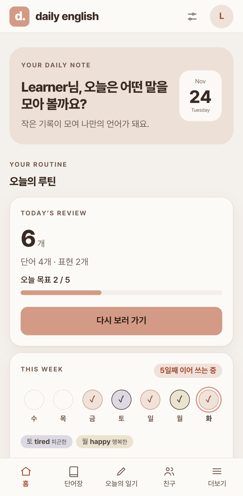
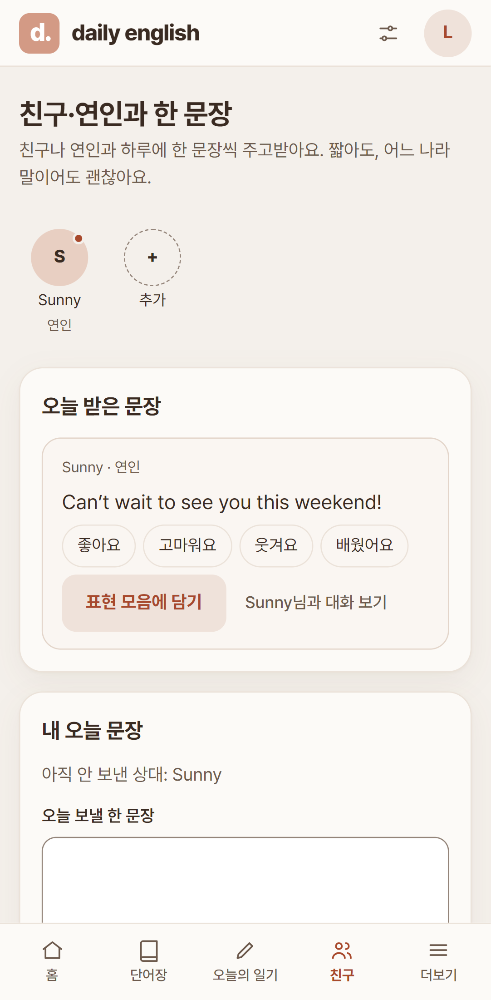
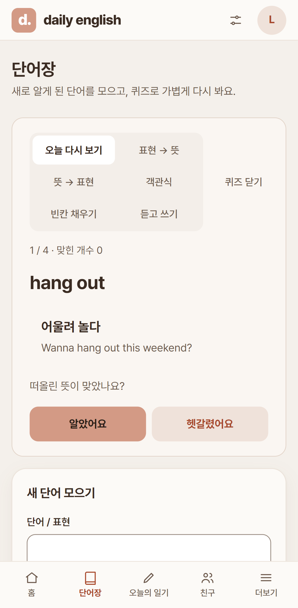
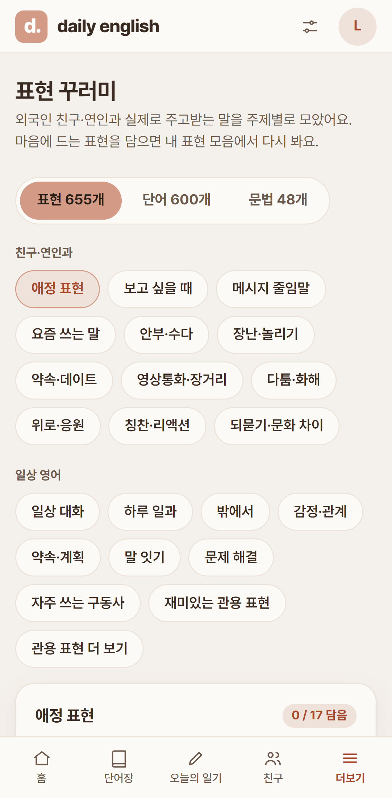
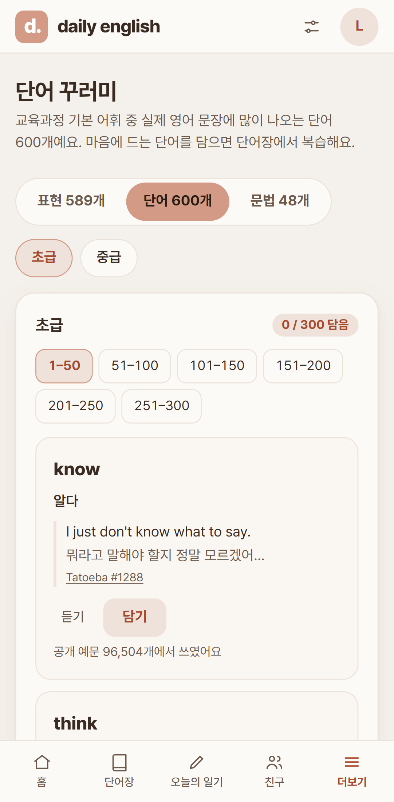
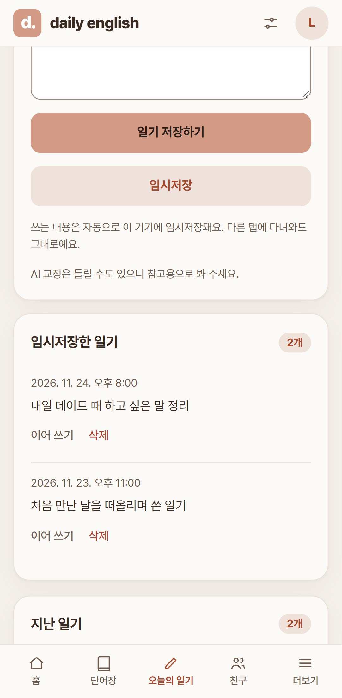
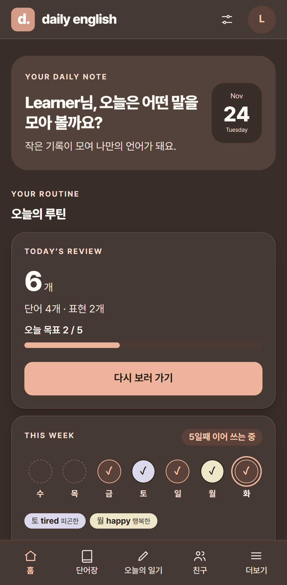

<p align="center">
  
</p>

<h1 align="center">Daily English</h1>

<p align="center">
  <b>외국인 친구와 나눈 말이 내 단어장이 되는 언어 기록 앱</b><br>
  작은 기록이 모여 나만의 언어가 돼요.
</p>

<p align="center">
  <a href="https://daily-english-eight-mocha.vercel.app">웹에서 바로 써 보기</a> ·
  안드로이드 앱 · 웹(PWA) · 회원가입 없이도 먼저 써 볼 수 있어요
</p>

<p align="center">
  
  
  
  
</p>

## 이런 분을 위한 앱이에요

외국인 친구나 연인과 메시지로 대화하는 사람이요. 교과서 문장이 아니라 **내가 실제로 주고받은 말**과 **친구끼리 진짜 쓰는 말**을 모으고, 잊을 때쯤 다시 꺼내 보게 해 줘요.

- 친구가 약속 잡을 때 보낸 `bet`은 무슨 뜻이지?
- 어제 일기에 쓴 문장, 원어민이라면 어떻게 말했을까?
- 일기 교정에서 배운 `used to`, 다음에는 틀리지 않을 수 있을까?

이런 순간을 기록하고, 고치고, 다시 연습하는 데 집중했어요.

## 무엇을 할 수 있나요

| | 기능 | 설명 |
| --- | --- | --- |
| 모으기 | 단어·표현·대화·일기 | 하루에 겪은 말을 네 가지로 기록해요. 단어와 표현은 일상·친구·연애·여행 같은 카테고리로 나누고, 내 카테고리를 직접 만들 수도 있어요. |
| 일기 | 달력으로 다시 보기 | 일기를 쓴 날이 달력에 표시되고, 날짜를 누르면 그날 일기를 바로 열어 봐요. |
| 고치기 | 일기 AI 교정 | 배우는 언어로 쓴 일기를 AI가 고쳐 주고, 고친 이유, **더 자연스러운 말**, 헷갈린 문법, 잘한 점을 나눠서 알려 줘요. |
| 연습 | 일기에서 배운 문법 | 교정에서 짚은 문법을 문법 노트에 담고, 번역하기와 직접 문장 만들기로 연습해요. AI가 맞았는지 확인해 줘요. |
| 다시 보기 | 간격 반복 복습·퀴즈 | 맞히면 점점 늦게, 틀리면 오늘 다시 보여 줘요. 자주 틀린 말은 "헷갈리는 말"로 따로 모아요. |
| 첫날부터 | 꾸러미 | 표현 727개(줄임말, 요즘 쓰는 말과 슬랭, 서로 알아 가기, 일·공부, 약속·장난·위로 등 25묶음), 단어 967개, 문법 61개를 담아 뒀어요. 욕설은 넣지 않았어요. |
| 함께 | 친구·연인과 한 문장 | 초대 번호로 친구는 10명까지, 연인은 1명과 짝이 되어 하루 한 문장씩 주고받아요. 오늘 모아보기에서 모두의 문장을 한눈에 보고, 새로고침하지 않아도 새 문장이 바로 보여요. |
| 지키기 | 임시저장·백업·오프라인 | 쓰던 일기는 자동으로 남고, 인터넷이 끊겨도 저장했다가 다시 연결되면 올려요. 지운 기록은 되돌릴 수 있어요. |

꾸러미는 영어 외에 일본어, 중국어, 스페인어, 프랑스어, 한국어로도 있어요.

<p align="center">
  
  
  
  
</p>

## 무료로 운영해요

기록, 복습, 퀴즈, 꾸러미, 친구 기능, 백업, AI 교정까지 모두 무료예요. 운영비가 들지 않는 서비스만 골랐어요.

- AI 교정은 Google Gemini의 무료 API를 써요. 처음 쓸 때 어디로 보내지는지 알리고 동의를 받아요.
- 무료 API라서 한 사람당 하루 교정 횟수가 정해져 있어요.

발표용으로 만든 Pro 시연판(Claude AI 교정, 보내기 전 메시지 다듬기, 받은 메시지 풀이, 주간 리포트)도 코드에 있지만 결제 기능은 없고, 관리자가 지정한 계정만 써요.

## 다른 앱과 무엇이 다른가요

| | 학습 앱(말해보카·스픽) | 단어장 앱(Quizlet·VoCat) | 일기 앱(Day One·하루콩) | **Daily English** |
| --- | --- | --- | --- | --- |
| 무엇을 배우나 | 회사가 만든 커리큘럼 | 내가 만든 카드 | 언어 학습 없음 | **내가 겪은 말 + 친구끼리 쓰는 말** |
| 복습 | O | O | X | O (간격 반복) |
| 일기·감정 기록 | X | X | O | O (+AI 교정, 문법 연습) |
| 친구와 같이 | X | 일부 | X | O (하루 한 문장) |
| 월 가격 | 16,000~29,000원 | 4,900~9,900원 | 2,500~12,000원 | **무료** |

## 감이 아니라 데이터로 정했어요

- **리뷰 5,142건 분석**: 비슷한 앱 11개의 리뷰에서, 사람들은 가격과 오류에 실망하고 재미·디자인·복습에 만족한다는 걸 확인했어요. 그래서 기록·복습은 무료로 두고, 데이터 유실을 막는 기능(삭제 되돌리기, 백업, 오프라인 저장)을 먼저 만들었어요.
- **원어민 영어 분석**: 공개 영어 문장 204만 개를 세어 보니, 어려운 건 새 단어가 아니라 쉬운 단어의 조합이었어요. 그 결과로 표현과 단어를 골랐어요.
- **가격 리뷰 991건 분석**: "비싸다"(4.4%)보다 환불·해지·자동 결제 불만이 훨씬 많았어요.

자세한 방법과 숫자는 [`analysis/`](https://github.com/ggpus111/daily_english/tree/main/analysis)에 있어요.

꾸러미의 설명과 예문은 AI와 함께 쓰고 사람이 골랐어요. **아직 원어민 검수 전**이라, 어색한 말을 발견하면 앱의 "의견 보내기"로 알려 주세요.

## 개인정보와 안전

- 내 기록은 나만 읽을 수 있어요(데이터베이스 행 단위 보안). 친구 문장은 같은 짝의 두 사람만 읽어요.
- 짝을 그만두면 내가 보낸 문장은 지워지고, 계정을 지우면 모든 기록이 함께 지워져요.
- 비밀 키는 코드에 넣지 않고 서버 금고(Supabase Secrets)에만 둬요. 웹사이트에는 보안 헤더(CSP, HSTS)를 걸었어요.
- 개인정보 처리방침은 앱의 설정에서 볼 수 있어요.

## 만든 방법

- **앱**: React + Vite. 웹(PWA)과 안드로이드 앱(Capacitor)을 같은 코드로 만들어요.
- **서버**: Supabase 서울 리전(데이터베이스, 로그인, 실시간, 서버 함수)
- **배포**: Vercel
- **AI**: Google Gemini(무료 API), Pro 시연판은 Claude(Anthropic)
- **품질**: 단위 테스트 192개, 데스크톱·모바일 브라우저 테스트(접근성 검사 포함), 안드로이드 에뮬레이터 테스트. 저장소에 올리면 자동으로 검사해요.

## 누가 만들었나요

친구가 만든 학습 노트 웹앱에서 시작했어요. 콘셉트("작은 기록이 모여 나만의 언어가 돼요"), 기록 4가지, 노트 디자인 틀은 친구의 원본에서 이어받았고, 안드로이드 앱, 복습, 데이터 안전, 꾸러미, 분석, AI 교정, 문법 연습, 친구 기능을 이어서 만들었어요.

코드와 콘텐츠 초안은 AI 코딩 도구(Claude Code)와 함께 만들었고, 무엇을 만들지와 어떤 기준으로 고를지는 사람이 정했어요. 자세한 내용은 [`docs/contribution.md`](https://github.com/ggpus111/daily_english/blob/main/docs/contribution.md)에 있어요.

## 개발자용

```bash
npm install
npm run dev
```

실행, 빌드, 안드로이드 앱, Supabase 설정, 배포, 테스트 방법은 [`docs/development.md`](https://github.com/ggpus111/daily_english/blob/main/docs/development.md)에 있어요.

콘텐츠 일부는 공개 문장 데이터 Tatoeba(CC BY 2.0 FR)를 썼고, 문장 번호로 출처를 표시했어요.
