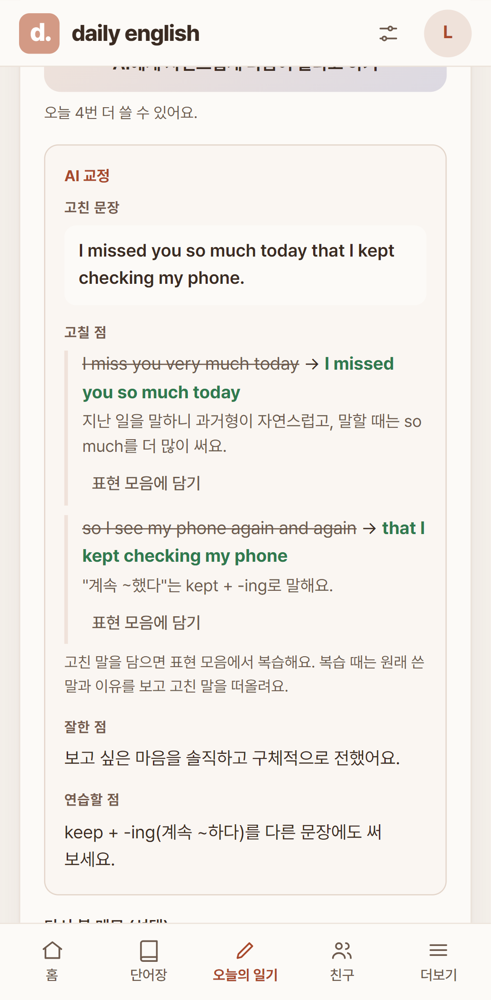
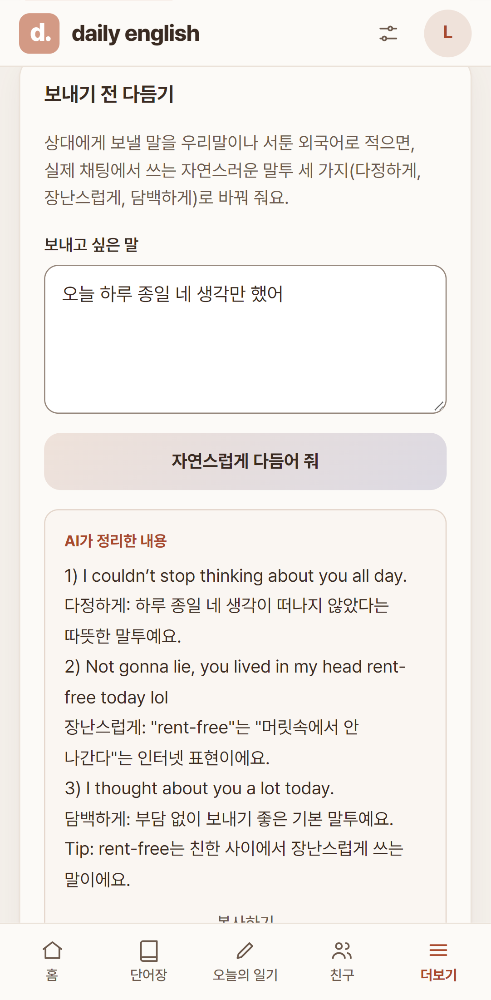
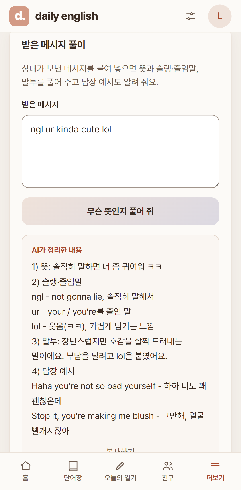
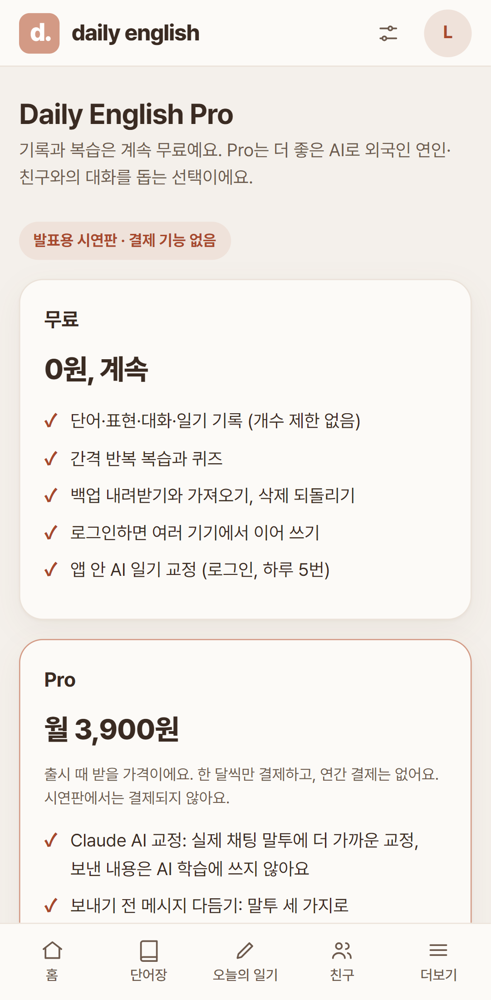

<p align="center">
  
</p>

<h1 align="center">Daily English</h1>

<p align="center">
  <b>외국인 연인·친구와 나눈 말이 내 단어장이 되는 언어 기록 앱</b><br>
  작은 기록이 모여 나만의 언어가 돼요.
</p>

<p align="center">
  <a href="https://daily-english-eight-mocha.vercel.app">웹에서 바로 써 보기</a> ·
  안드로이드 앱 · 웹(PWA)
</p>

<p align="center">
  
  
  
  
</p>

## 이런 분을 위한 앱이에요

외국인 연인이나 친구와 메시지로 대화하는 사람이요. 교과서 문장이 아니라 **내가 실제로 주고받은 말**을 모으고, 잊을 때쯤 다시 꺼내 보게 해 줘요.

- "보고 싶다"를 영어로 어떻게 보냈더라?
- 상대가 보낸 `ngl`, `lowkey`가 무슨 뜻이지?
- 오늘 쓴 영어 일기, 자연스러운 말투였을까?

이런 순간을 기록하고, 고치고, 복습하는 데 집중했어요.

## 무엇을 할 수 있나요

| | 기능 | 설명 |
| --- | --- | --- |
| 모으기 | 단어·표현·대화·일기 | 하루에 겪은 말을 네 가지로 기록해요. 대화 기록은 "어떤 상황에서 한 말인지"까지 남겨요. |
| 고치기 | 일기 AI 교정 | 우리말로 쓰고 배우는 언어로 옮기면, AI가 고친 문장과 이유, 잘한 점을 알려 줘요. 고친 말은 바로 표현 모음에 담을 수 있어요. |
| 다시 보기 | 간격 반복 복습·퀴즈 | 맞히면 점점 늦게, 틀리면 오늘 다시 보여 줘요. 자주 틀린 말은 "헷갈리는 말"로 모아 줘요. |
| 첫날부터 | 표현·단어 꾸러미 | 연인·친구 대화, 일상 표현, 단어를 6개 언어(영어, 일본어, 중국어, 스페인어, 프랑스어, 한국어)로 담아 뒀어요. |
| 함께 | 친구·연인과 한 문장 | 초대 번호로 짝이 되어 하루 한 문장씩 주고받아요. 새로고침하지 않아도 상대 문장이 바로 보여요. |
| 문법 | 문법 노트 | 헷갈리는 문법을 적어 두고 번역·작문으로 연습해요. |
| 지키기 | 임시저장·백업·오프라인 | 쓰던 일기는 자동으로 남고, "임시저장"으로 따로 치워 둘 수도 있어요. 인터넷이 끊겨도 저장했다가 다시 연결되면 올려요. |

<p align="center">
  
  
  
  
</p>

## Pro (월 3,900원, 발표용 시연판)

기록·복습·백업은 계속 무료예요. Pro는 "더 많이"가 아니라 **"더 좋은 AI"**로 대화를 돕는 선택이에요.

- **Claude AI 교정**: 실제 채팅 말투에 더 가까운 교정. 보낸 내용은 AI 학습에 쓰지 않아요.
- **보내기 전 메시지 다듬기**: 보내려는 말을 다정하게·장난스럽게·담백하게, 세 가지 말투로 바꿔 줘요.
- **받은 메시지 풀이**: 상대 메시지의 뜻, 슬랭·줄임말, 말투를 풀어 주고 답장 예시도 알려 줘요.
- **주간 AI 리포트**: 이번 주 일기에서 자주 틀린 점과 다음 주에 써 볼 표현을 정리해 줘요.
- **학습 통계**: 최근 4주 기록, 기억 단계, 앞으로의 복습

아직 결제 기능은 없고, 관리자가 지정한 계정만 Pro를 써요. 유료로 바꿀 때도 연간 결제와 체험 뒤 자동 결제는 하지 않기로 했어요.

<p align="center">
  
  
</p>

## 다른 앱과 무엇이 다른가요

| | 학습 앱(말해보카·스픽) | 단어장 앱(Quizlet·VoCat) | 일기 앱(Day One·하루콩) | **Daily English** |
| --- | --- | --- | --- | --- |
| 무엇을 배우나 | 회사가 만든 커리큘럼 | 내가 만든 카드 | 언어 학습 없음 | **내가 겪은 말** |
| 복습 | O | O | X | O (간격 반복) |
| 일기·감정 기록 | X | X | O | O (+AI 교정) |
| 월 가격 | 16,000~29,000원 | 4,900~9,900원 | 2,500~12,000원 | **핵심 무료, Pro 3,900원** |

## 감이 아니라 데이터로 정했어요

- **리뷰 5,142건 분석**: 비슷한 앱 11개의 리뷰에서, 사람들은 가격과 오류에 실망하고 재미·디자인·복습에 만족한다는 걸 확인했어요. 그래서 기록·복습은 무료로 두고, 데이터 유실을 막는 기능(삭제 되돌리기, 백업, 오프라인 저장)을 먼저 만들었어요.
- **원어민 영어 분석**: 공개 영어 문장 204만 개를 세어 보니, 어려운 건 새 단어가 아니라 쉬운 단어의 조합이었어요. 그 결과로 표현 400개와 단어 600개를 골랐어요.
- **가격 리뷰 991건 분석**: "비싸다"(4.4%)보다 환불·해지·자동 결제 불만이 훨씬 많았어요. 그래서 한 달씩만, 자동 결제 없이로 정했어요.

자세한 방법과 숫자는 [`analysis/`](analysis/)에 있어요.

## 개인정보와 안전

- AI 교정은 처음 쓸 때 어디로 보내지는지 알리고 동의를 받아요. 보내는 곳이 바뀌면 다시 물어봐요.
- 친구·연인 문장은 같은 짝의 두 사람만 읽을 수 있어요(데이터베이스 행 단위 보안). 짝을 그만두면 내가 보낸 문장은 지워져요.
- AI 교정은 한 사람당 하루 횟수가 정해져 있고, 이미 교정받은 일기를 다시 받을 때는 먼저 물어봐요.
- 개인정보 처리방침은 앱의 설정에서 볼 수 있어요.

## 만든 방법

- **앱**: React + Vite, 웹(PWA)과 안드로이드 앱(Capacitor)을 같은 코드로 만들어요.
- **서버**: Supabase(데이터베이스, 로그인, 실시간, 서버 함수)
- **AI**: Claude(Anthropic)가 기본이고, 바쁠 때는 Gemini(Google)가 대신 받아요.
- **품질**: 단위 테스트 192개, 브라우저 테스트 146번(데스크톱·모바일, 접근성 검사 포함). 저장소에 올리면 자동으로 검사해요.

## 누가 만들었나요

친구가 만든 학습 노트 웹앱에서 시작했어요. 콘셉트("작은 기록이 모여 나만의 언어가 돼요"), 기록 4가지, 노트 디자인 틀은 친구의 원본에서 이어받았고, 안드로이드 앱, 복습, 데이터 안전, 꾸러미, 분석, AI 교정, 친구·연인 기능을 이어서 만들었어요.

코드와 콘텐츠 초안은 AI 코딩 도구(Claude Code)와 함께 만들었고, 무엇을 만들지와 어떤 기준으로 고를지는 사람이 정했어요. 자세한 내용은 [`docs/contribution.md`](docs/contribution.md)에 있어요.

## 개발자용

```bash
npm install
npm run dev
```

실행, 빌드, 안드로이드 앱, Supabase 설정, 배포, 테스트 방법은 [`docs/development.md`](docs/development.md)에 있어요.

콘텐츠 일부는 공개 문장 데이터 Tatoeba(CC BY 2.0 FR)를 썼고, 문장 번호로 출처를 표시했어요.
